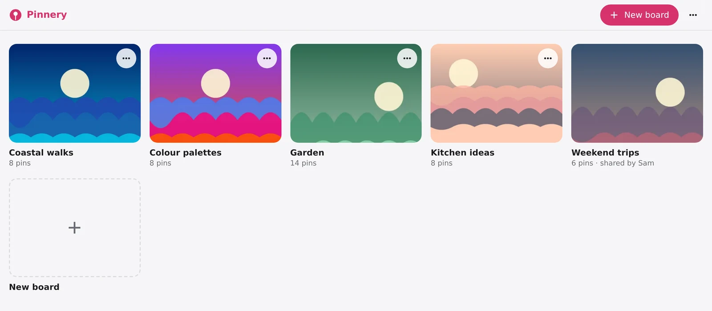
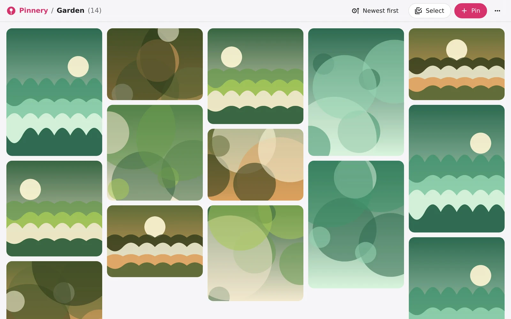
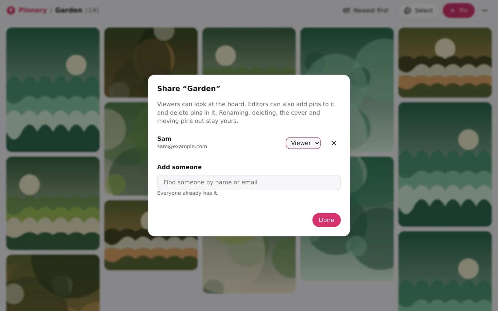
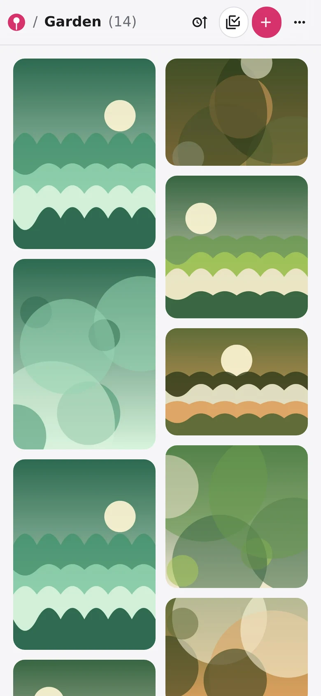

# Pinnery

[](https://github.com/danjam/pinnery/actions/workflows/test.yml)
[](https://github.com/danjam/pinnery/releases/latest)
[](LICENSE)
[](package.json)
[](https://github.com/danjam/pinnery/pkgs/container/pinnery)

Your own private Pinterest. Save images from anywhere into boards, browse them in a tidy grid, and share boards with the people you choose. It runs on your own server, so your pins stay yours.

- **Boards** with cover images, a masonry grid and a full-screen viewer
- **Save from anywhere**: a Chrome extension (right-click any image), your phone's share menu, or drag, drop, paste and upload in the app
- **Share boards** with family or friends, as viewers or editors
- **Accounts by invite only**: nobody can sign up uninvited
- **Export and import** your boards as a zip at any time
- Light and dark mode, a choice of accent colours, works on desktop and phone





<p>
  
  
</p>

## Getting started

You'll need Docker. Create a `compose.yaml`:

```yaml
services:
  pinnery:
    image: ghcr.io/danjam/pinnery:latest
    restart: unless-stopped
    environment:
      # The first (admin) account. The password only gets you in the first time:
      # you'll be asked to choose a new one when you sign in.
      PINNERY_ADMIN_EMAIL: you@example.com
      PINNERY_PASSWORD: change-me

      # The address people use to reach Pinnery. Used in emailed links.
      PINNERY_PUBLIC_URL: https://pinnery.example.com

      # Email is optional: see docs/email.md. Without it, invite and
      # password-reset links are shown on screen instead.

      # How many reverse proxies sit in front of Pinnery. 1 (the default)
      # suits one proxy such as Traefik or Caddy. Use 0 if there's none.
      # PINNERY_PROXIES: 1

      TZ: Europe/London
    volumes:
      - ./data:/data                     # your images and database
    ports:
      - "3420:3420"
    # Hardening: Pinnery only writes to /data, needs no Linux capabilities, and never needs more
    # privileges than it starts with.
    read_only: true
    cap_drop: [ALL]
    security_opt:
      - no-new-privileges:true
```

The image has a built-in healthcheck, so Docker shows whether Pinnery is healthy without any extra setup.

The container runs as user id 1000, so create the data folder with that owner first: `mkdir data && sudo chown 1000:1000 data`.

Pinnery is meant to sit behind a reverse proxy with HTTPS (Caddy, Traefik, Nginx Proxy Manager…). Sign-in, the phone app and the extension all expect it. Once that's set up, start Pinnery with `docker compose up -d`, open your Pinnery address, and sign in with that email and password. You'll be asked to choose a new password straight away. The one in the file is only used to get you in the first time.

Just trying it out? `http://your-server:3420` works too. If people use Pinnery that way for real, with no proxy in front, set `PINNERY_PROXIES: 0` (see [Proxies and sign-in limits](docs/proxies.md)).

## Documentation

- [Settings](docs/settings.md): every environment variable
- [Proxies and sign-in limits](docs/proxies.md): `PINNERY_PROXIES`, and why it matters
- [Email](docs/email.md): what Pinnery sends, and setting it up
- [Accounts and sharing](docs/accounts-and-sharing.md): invites, viewers and editors, passwords, admins
- [Chrome extension](docs/extension.md): pin any image on the web
- [On your phone](docs/phone.md): install the app and share images to it
- [Backups and updates](docs/backups-and-updates.md): your data, and upgrading Pinnery

## Licence

MIT. Icons from [Material Design Icons](https://pictogrammers.com/library/mdi/) (Apache-2.0); see [NOTICE](NOTICE).
